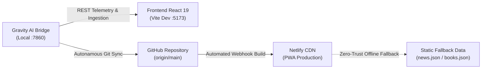

# 🏗️ Arquitectura del Nexo Ágora (V16.2 PRO)

Este documento detalla la topología de software, subsistemas y mecanismos avanzados de resiliencia implementados en **Gravity News Portal**.

---

## 1. Topología del Ecosistema Decoupled Zero-Trust

El portal se fundamenta en una separación estricta entre la capa de presentación pública y el motor de inteligencia privado:



1. **Frontend React 19 (SPA + PWA):** Construido sobre Vite 8, React 19, Framer Motion y Workbox Service Worker. Desplegable en cualquier CDN estática con costo de infraestructura \$0.00.
2. **Backend Local (Gravity AI Bridge):** Servidor HTTP multi-sesión residente en `http://localhost:7860` con catálogo multi-modelo (LM Studio, Groq, Nvidia NIM) y motor de homeostasis Vigía.
3. **Persistencia Local Reactiva:** Las noticias generadas se almacenan en una cola FIFO de 15 artículos en `localStorage` (`gravity-custom-news`), transmitiéndose mediante eventos personalizados `gravity-news-updated` para sincronizar vistas en tiempo real sin requerir recarga.

---

## 2. Fortificaciones Arquitectónicas (Estándar Mythos 5)

### A. Sanitización Estricta Multi-Capa (Anti-XSS)
* **Pre-escape de Markdown:** [`TypewriterMarkdown.jsx`](../src/components/TypewriterMarkdown.jsx) sanea el texto eliminando caracteres de control y escapando etiquetas antes del análisis sintáctico.
* **Aislamiento DOM con DOMParser:** En [`Reader.jsx`](../src/pages/Reader.jsx), el HTML crudo de los libros se procesa a través de una instancia aislada de `DOMParser`, eliminando de forma recursiva elementos `<script>`, hojas de estilo externas no autorizadas y controladores de eventos inline (`onclick`, `onerror`, etc.).

### B. Ciclos de Vida Controlados (Page Visibility & AbortControllers)
* **Sondeo Reactivo al Enfoque:** Componentes con polling (`Home.jsx`, `Sidebar.jsx`, `TerminalFeed.jsx`) interceptan el evento `visibilitychange`. Si `document.hidden === true`, los temporizadores pausan su ejecución para no consumir CPU ni ancho de banda.
* **Cancelación de Peticiones:** Todo `fetch` se enlaza a una señal `controller.signal`. Al desmontar el componente, la señal aborta inmediatamente la conexión, previniendo advertencias de fugas de memoria o ejecuciones huérfanas.

### C. Mapeo Telemetría Vigía / Homeostasis
* En [`Sidebar.jsx`](../src/components/Sidebar.jsx), la deserialización del endpoint `/v1/autonomy/status` se adapta a la estructura real emitida por `bridge_server.py`:
  - `last_status_level` (NORMAL / CRITICAL / ANOMALY)
  - `cycles_done` y `actions_taken`
  - `budget_remaining_usd`
  - Métricas de entropía homeostática del reportero.

### D. Audio Synthesis Persistente
* En [`ArticleModal.jsx`](../src/components/ArticleModal.jsx), se evita el bug histórico de Chromium en el que instancias huérfanas de `SpeechSynthesisUtterance` eran recolectadas por el *Garbage Collector* a los 15 segundos cortando el audio. Se mantiene una referencia mutable persistente (`utteranceRef.current`) hasta el evento `onend`.

### E. Invulnerabilidad de Enrutamiento (`ChunkLoadError`)
```jsx
<AnimatePresence mode="wait">
  <ErrorBoundary key={location.pathname}>
    <Routes>
      <Route element={<Suspense fallback={<PageLoader />}> ... </Suspense>} />
    </Routes>
  </ErrorBoundary>
</AnimatePresence>
```
* La clave `key={location.pathname}` regenera el límite de error al cambiar de ruta, evitando que un fallo transitorio de la red bloquee la navegación general.

### F. Rendimiento Anti-Storm (Render-Phase Updates)
* En contextos y entradas globales (búsqueda, tickers), se prohíbe el uso de `useEffect` para actualizar estados derivados. Se emplea el patrón nativo de React 19 de actualización en fase de render con `prevValue` y debounce de 300 ms.

### G. Resiliencia del Filesystem en Windows (Vite Watcher)
* La directiva `server.watch.ignored: ['**/src/data/**/*.json', '**/public/books/**']` en `vite.config.js` evita que procesos automáticos como `sync_books.py` bloqueen descriptores de archivos (`EBUSY`) e interrumpan el servidor de desarrollo.
